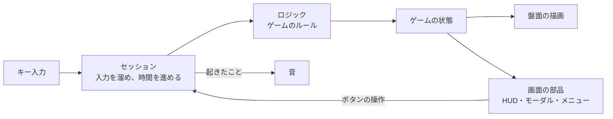
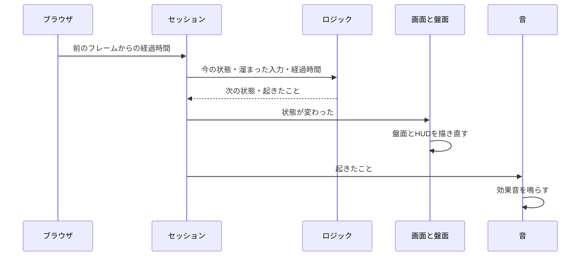
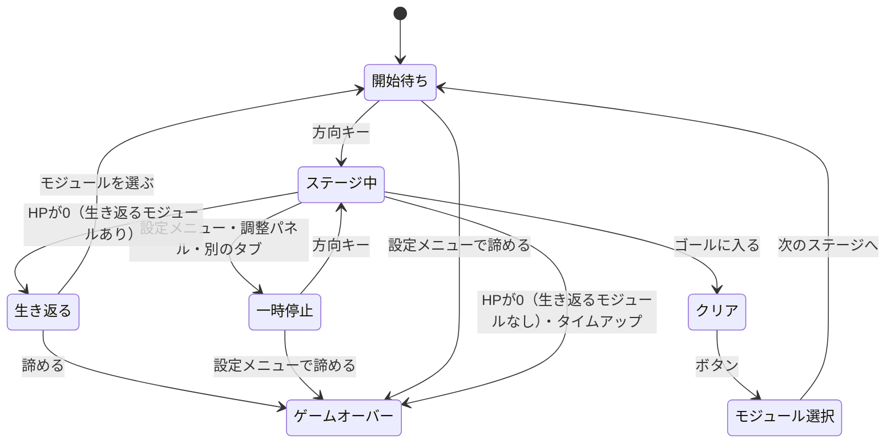

# 1. 全体像

ログスネがどう作られているかを、コードを読まずにつかむためのドキュメント。チームの全員が読めるように、仕組みを図で示し、コードの細部には入らない。

- ゲームのルールは[コンセプト](../concept.md)、決めた理由は[議論の記録](../discussions/)、言葉の意味は[用語集](../../GLOSSARY.md)にある
- どのファイルに何があるかは[2. 構成とつながり](./2-構成とつながり.md)、判定や計算の中身は[3. 実装とアルゴリズム](./3-実装とアルゴリズム.md)に書く

## どんなゲームか

スネークを操作してバッテリーを食べ、決められた数を食べると現れるゴールに入るとステージクリアになる。クリアするたびに、集めたPPでモジュール（強化）を買い、どこまでステージを進めるかを競う。長さはステージをまたいで持ち越すので、進むほど盤面が窮屈になる。詳しいルールはコンセプトにある。

## 役割ごとに分けた作り

コードは役割ごとの部分（層）に分かれている。中心にあるのは、ゲームのルールだけを書いたロジックである。ロジックは「今の状態」と「入力」と「経過時間」を受け取り、「次の状態」と「起きたこと（イベント）」を返す。画面に何かを描いたり、音を鳴らしたりはしない。

| 層 | すること | しないこと |
|---|---|---|
| ロジック | 状態と入力から、次の状態と起きたことを決める | 画面や音、ブラウザの機能に触れる |
| セッション | キー入力を溜め、時間を進め、今どの画面かを持つ | ゲームのルールを決める |
| 盤面の描画 | 状態を読んで、盤面をCanvasに描く | 状態を書き換える |
| 画面の部品 | 状態を読んでHUDやモーダルを出し、ボタンの操作をセッションに渡す | 状態を直接書き換える |
| 音 | 起きたこと（バッテリーを食べた、など）を聞いて、効果音を鳴らす | 状態を書き換える |

こう分けたのは、データの流れを「状態から描画へ」の一方向にそろえ、AIに書かせたコードを読んで理解しやすくするためである（技術構成を決めたときの理由）。分けた結果、ロジックは入力と出力だけで動くので、ブラウザを開かずにテストで動きを確かめられる。テストは250件以上あり、PRを出すたびにCIで走る。層をまたぐ読み込みの向き（ロジックが画面を読み込まない、など）は、lintで機械的に検査している。

## 1フレームでゲームが進む流れ

ブラウザは画面を描き直すたびに（多くの画面で1秒に60回）ゲームを進める。1回分の流れは次のとおり。

スネークは毎フレーム動くわけではない。経過時間を貯めていき、移動の間隔（既定は150ミリ秒）に達したら1マス進む。制限時間も同じ経過時間から減らしている。

## ゲームの局面と画面の切り替わり

ロジックは、今のゲームが「どの局面にあるか」を持っている。画面の部品は局面を見て、出すものを選ぶ。局面の移り変わりは次のとおり。

タイトル画面だけは、ロジックの局面ではなくセッションが持っている。ランが始まる前の画面だからである。タイトルにいるあいだ、セッションはゲームを進めない。

ぶつかって止まっている状態は、局面を分けず「ステージ中」の中で持つ。止まっているあいだも制限時間は減るので、ゲームの時間の流れ方はステージ中と同じだからである。

## 数値と、ブラウザに保存するもの

移動の間隔、制限時間、モジュールの値段、壁のパターンなどの数値は、既定値を1か所にまとめている。遊んでいるときにTキーを押すと調整パネルが開き、これらを変えて試せる。

ブラウザに保存するものは2つある。

- 調整した数値: 既定値から変えた項目だけを保存する。既定値を変えて公開すれば、前に遊んだブラウザにも新しい既定値が届く
- プレイヤーの設定: 言語（日本語・英語）と、BGM・効果音の音量

## 配り方

完成したゲームは画像や音も含めて1つのHTMLファイルにまとめる。zipで配ると、別ファイルのJavaScriptが読み込まれないことがあるためである。mainブランチにマージすると、GitHub Pagesに自動で公開される。
