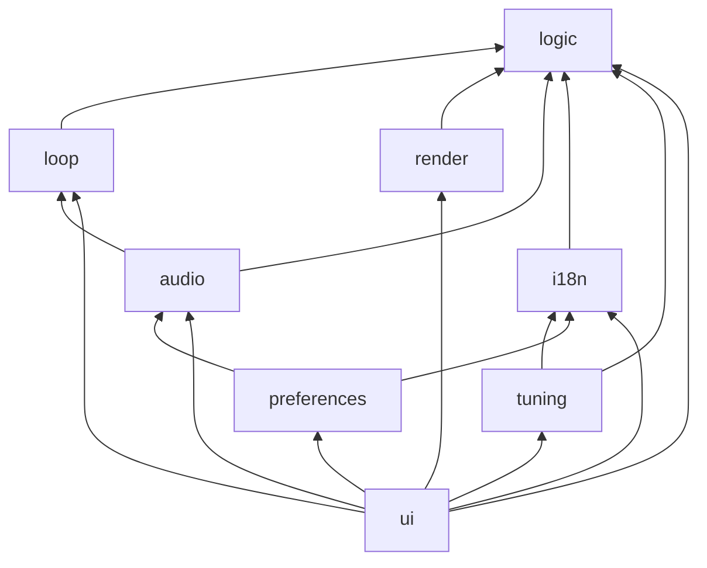
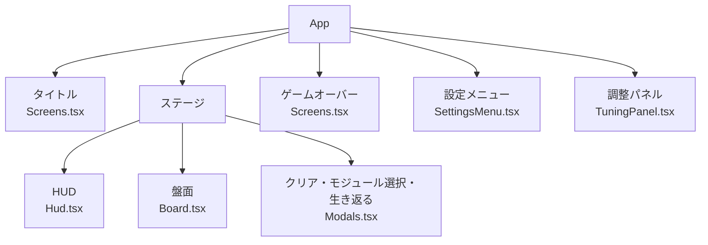

# 2. 構成とつながり

コードを読む人のための地図。どのフォルダに何があり、データがどの順に流れるかを、ファイルと関数の名前で示す。全体の考え方は[1. 全体像](./1-全体像.md)、判定や計算の中身は[3. 実装とアルゴリズム](./3-実装とアルゴリズム.md)を参照する。

コードを写すと古くなるので、ここではファイルと関数の名前で指す。中身はそのファイルを読む。

## 技術構成

| 用途 | 使っているもの | 選んだ理由 |
|---|---|---|
| 言語 | TypeScript | 状態の型（局面ごとに持つものが違う）を、型で検査するため |
| 画面の部品 | React | タイトル、HUD、モーダルなど、状態に合わせて出し分ける部品が多いため |
| 盤面の描画 | Canvas（ブラウザの標準機能） | 下の「ゲームのライブラリを使わない理由」を参照 |
| 見た目 | Tailwind CSS、shadcn/ui（Radix） | 学習も兼ねて使う。[開発の仕組みと各層の見直し](../discussions/2026-11-07-開発の仕組みと各層の見直し.md) |
| 外から読む値の検査 | zod | 調整のJSONと保存した設定の検査。[外から読む値の検査と型の整理](../discussions/2026-11-07-外から読む値の検査と型の整理.md) |
| 開発の道具 | Vite+（Vite、Vitest、oxlint、oxfmtをまとめたもの） | [Vite+への切り替え](../discussions/2026-11-07-Vite+への切り替え.md) |
| パッケージ管理 | pnpm | [開発の仕組みと各層の見直し](../discussions/2026-11-07-開発の仕組みと各層の見直し.md) |
| 1つのHTMLにまとめる | vite-plugin-singlefile | zipで配ると、別ファイルのJavaScriptが読み込まれないことがあるため |
| CIと公開 | GitHub Actions、GitHub Pages | mainにマージすると公開される |
| フォント | Google Fonts（WDXL Lubrifont JP N） | [タイトル・フォント・音](../discussions/2026-11-06-タイトル・フォント・音.md) |

nodeとpnpmのバージョンは`package.json`で決めている（`devEngines`と`packageManager`）。

### ゲームのライブラリを使わない理由

PhaserやPixiJSのようなゲームのライブラリは使わず、盤面はCanvasに直接描いている。

- 盤面はマス単位で動くので、Phaserの強み（物理演算、当たり判定、スプライトのアニメーション、シーン管理）をほぼ使わない
- Phaserを入れると、ゲームの状態と画面上の絵を同期させるコードや、Reactに組み込むコードが増える。自分で書く部品（ゲームループ、画像の読み込み、音、点滅）は、どれも小さい
- 状態から描画への一方向の流れにそろえられ、AIに書かせたコードを読んで理解しやすい
- PixiJSは描画だけのライブラリで、この規模ではCanvasに直接描くのと差が小さい

重くなった部分があれば、その部分だけ小さな専用のライブラリ（音ならHowler.jsなど）に置き換える方針にしている。

## フォルダと層

`src/`の下は層ごとのフォルダに分かれている。

| フォルダ | 層 | 中身 |
|---|---|---|
| `logic/` | ロジック | ゲームのルール。純関数だけで、ブラウザの機能を使わない |
| `loop/` | セッション | キー入力、ゲームループ、今どの画面か |
| `render/` | 盤面の描画 | Canvasに盤面を描く。素材の画像の読み込み |
| `audio/` | 音 | どの場面でどの音を鳴らすかと、再生 |
| `ui/` | 画面の部品 | Reactの画面（タイトル、HUD、モーダル、設定メニュー、調整パネル） |
| `components/ui/` | 画面の部品の素材 | shadcn/uiの部品（ボタン、ダイアログ、スライダーなど） |
| `tuning/` | 調整した数値 | 調整パネルの項目の決まり、JSONの検査、保存 |
| `preferences/` | プレイヤーの設定 | 言語と音量の保存 |
| `i18n/` | 文言 | 日本語と英語の文言 |
| `lib/` | 共通の小さな関数 | 型付きでキーを並べる関数など |

`config.ts`は、数値の既定値（`CONFIG`）、モジュールの値段と上限（`MODULES`）、既定の壁のパターン（`WALL_PATTERNS`）、音量の既定値（`AUDIO`）をまとめている。`main.tsx`は、これらをつないで起動する。

### 読み込みの向き

層をまたぐ読み込みは決まった向きにだけ許す。違反は`vite.config.ts`の`lint.overrides`で検査している。

`config.ts`と`lib/`はどの層からも読み込んでよい（図では省いている）。

- `logic`は、`config.ts`と`lib/`のほかは読み込まない
- `loop`は、画面・音・保存を知らない
- `render`は、ゲームの状態だけを読む
- `audio`・`tuning`・`preferences`・`i18n`は、画面の部品と描画を読み込まない

## 起動の流れ

`main.tsx`は、次の順に部品を作ってつなぐ。

1. ブラウザに保存された調整（`tuning/storage.ts`の`createTuningStorage`）と、プレイヤーの設定（`preferences/storage.ts`の`createPreferencesStorage`）を読む
2. セッションを作る（`loop/session.ts`の`createSession`）。最初のランもここで作る
3. 音の再生を作り（`audio/player.ts`の`createAudioPlayer`）、セッションにつなぐ（`audio/director.ts`の`connectAudio`）
4. 「Loading…」を出し、素材の画像をすべてデコードし終えるまで待つ（`render/loadSprites.ts`の`loadSprites`）
5. ゲームループを始め（`loop/run.ts`の`startLoop`）、画面（`ui/App.tsx`の`App`）を描く

## ゲームの状態

状態の型は`logic/types.ts`にまとまっている。

### 局面（`Game`）

`Game`は、局面（`phase`）ごとに持つものが違う判別共用体である。

| 局面 | 意味 | 持つもの |
|---|---|---|
| `awaitingStart` | ステージ開始待ち（生き返った直後も） | ラン、ステージ |
| `playing` | ステージ中（ぶつかって止まっているあいだも含む） | ラン、ステージ、動き |
| `paused` | 一時停止 | ラン、ステージ、動き |
| `reviveChoice` | 生き返るモーダル | ラン、ステージ |
| `cleared` | クリアのモーダル | ラン、ステージ、クリアの内訳 |
| `shop` | モジュール選択 | ラン、候補 |
| `gameOver` | ゲームオーバー | ラン、死因 |

### ランの状態（`RunState`）

ステージをまたいで持ち越すもの。長さ、HP、所持PP、累計獲得PP、スコア、到達ステージ、乱数の状態、そのランの数値（`Tuning`）を持つ。

モジュールは2つの一覧で持つ。

- `modules`: 今持っているもの。使い切るモジュールは使うと1つ減る
- `purchased`: ラン中に買った記録。使っても減らない。ゲームオーバー画面に出す

HPの上限や制限時間のようなモジュールの効果は、状態に書き込まず、`modules`から毎回計算する（`logic/modules.ts`の`effectsOf`）。

### ステージの状態（`StageState`）

ステージごとに作り直すもの。体（先頭が頭）、壁、バッテリーとその種類、ゴール、ハート、制限時間と残り時間、食べたバッテリーの数、このステージで得たPPを持つ。

### 動き（`Movement`）

最初の方向キーを押してから存在する。向き、溜まった入力、動いているか止まっているか（`Motion`）、無敵の残り時間を持つ。

### 起きたこと（`GameEvent`）

ロジックが状態と一緒に返す。バッテリーを食べた、ぶつかった（ダメージの有無つき）、ハートを取った、ゴールが出た、クリアした、HPが0になった、タイムアップ、生き返った、の8種類。音はこれを聞いて鳴らす。

## セッション（`loop/`）

`loop/session.ts`の`createSession`が返すセッションは、2つのストア（値と購読の組。`loop/store.ts`）を持つ。

- `store`: ゲームの状態（`Game`）
- `view`: ロジックの外にある画面の状態（`loop/view.ts`の`View`）。タイトルにいるか（`onTitle`）、設定メニューが開いているか（`menuOpen`）、調整パネルが開いているか（`panelOpen`）

今どの画面かはこの2つから決まる（`loop/view.ts`の`screenOf`。タイトル・ステージ・ゲームオーバーのどれか）。

セッションの操作は次のとおり。

| 操作 | 呼ぶ人 | すること |
|---|---|---|
| `command` | キー入力（`loop/run.ts`） | 方向キーを溜める。Escで設定メニュー、Tで調整パネルを開閉する（開くと一時停止） |
| `advance` | ゲームループ（`loop/run.ts`） | 溜まった入力と経過時間でロジックの`step`を呼ぶ |
| `perform` | 画面のボタン | モジュール選択を開く、買う、リロール、次のステージへ、生き返る、諦める。ゲームオーバーになったら、設定メニューを閉じる |
| `restart` | 調整パネル | 渡した数値で新しいランを始める |
| `startNewRun` / `goToTitle` | タイトル・ゲームオーバー画面 | 新しいランを始めてタイトルを出る / タイトルに戻る |
| `pause` | ゲームループ（タブを離れたとき） | ステージ中なら一時停止にする |
| `onChange` | 音（`audio/director.ts`） | 状態が変わるたびに、前の状態・次の状態・起きたことを知らせる |

タイトルにいるあいだと、設定メニューか調整パネルが開いているあいだは、`command`の方向キーも`advance`も何もしない。

`loop/run.ts`の`startLoop`は`requestAnimationFrame`でフレームごとに`advance`を呼ぶ。キー入力は`loop/keys.ts`の`commandOfKey`で操作に変える。入力欄で文字を打っているあいだは、Esc以外のキーをゲームに渡さない。

## ロジック（`logic/`）

外から呼ぶ関数は次のとおり。どれも、その局面でできない操作なら状態を変えずに返す。

| 関数 | ファイル | 局面の移り方 |
|---|---|---|
| `startRun` | `game.ts` | 新しいランの`awaitingStart` |
| `step` | `game.ts` | `awaitingStart`→`playing`、`playing`→`cleared`・`reviveChoice`・`gameOver`、`paused`→`playing` |
| `pause` | `game.ts` | `playing`→`paused` |
| `revive` | `game.ts` | `reviveChoice`→`awaitingStart` |
| `giveUp` | `game.ts` | `reviveChoice`→`gameOver`（死因はHP 0）、`paused`・`awaitingStart`→`gameOver`（死因は「諦めた」） |
| `openShop` | `shop.ts` | `cleared`→`shop` |
| `buyModule` / `reroll` | `shop.ts` | `shop`のまま |
| `nextStage` | `game.ts` | `shop`→次のステージの`awaitingStart` |

そのほかのファイルは、`step`などが使う部品である。

- `board.ts`: マスの計算（中央、隣、盤面の内か外か）と、ものを置けるマスの選び方
- `modules.ts`: モジュールの効果の計算、生き返ったときのHP、使い切るモジュールの消費
- `rng.ts`: シード付きの乱数
- `wallPatterns.ts`: 壁のパターンの検査と、盤面への置き方
- `testing.ts`: テスト用の補助（盤面を15×15に固定した数値など）

## 画面の部品（`ui/`）

`ui/App.tsx`の`App`がセッションの2つのストアを`useSyncExternalStore`で読み、画面を選ぶ。

- 表示用の値は`ui/view.ts`で作る（モジュールの候補の値段や買えるか、HUDのモジュールの残りの数、生き返る選択肢）
- モーダルは`ui/GameDialog.tsx`で、局面で開閉が決まるので、Escや外側のクリックでは閉じない。モーダルを終える操作のボタンは`actions`で渡し、一番下の真ん中に並ぶ
- ボタンは`ui/GameButton.tsx`で、素材の枠の画像があれば枠を伸ばして使う
- 盤面とHUDの幅は`ui/layout.ts`で決める。画面に収まらなければ盤面を縮め、HUDには詰まらない幅を残す
- ボタンを押した音は、`App`がまとめて鳴らす（自分の音があるボタンには`data-silent`を付けて除く）

## 盤面の描画（`render/`）

`ui/Board.tsx`が、状態が変わるたびに`render/draw.ts`の`drawGame`を呼ぶ。描く順は床、壁、スネーク、バッテリー、ゴール、ハート。画像がないものは図形で描く。

- `render/sprites.ts`: 素材のファイル名の一覧（`SPRITE_FILES`）と、どの絵を使うかの選び方（スネークの各マス、壁、床）
- `render/loadSprites.ts`: 素材の画像を読み込む。単一HTMLに入れる画像を絞るため、ファイル名を並べて書いている。`SPRITE_FILES`とそろっていることはテストで確かめる
- `render/style.ts`: マスの大きさ（32px）と、盤面の色。色は`src/index.css`のテーマにだけ書き、起動時にCSSの変数から読む

## 音（`audio/`）

`audio/director.ts`の`connectAudio`がセッションの変化を聞いて音を決める。

- 効果音: 起きたことから選ぶ（`audio/cues.ts`の`soundsFor`）
- BGMの音量: 今の画面と局面から、ふつうか下げるかを選ぶ（`audio/cues.ts`の`bgmLevel`）
- BGMはタイトルを出るとき（「ゲーム開始」のクリックの中）に流し始める

再生そのものは`audio/player.ts`がする。どの音を鳴らすかは決めない。

## 調整した数値とプレイヤーの設定

- `tuning/fields.ts`: 調整パネルの項目と、値の決まり（最小・最大・整数か）
- `tuning/parse.ts`: 調整のJSONを、zodのスキーマで検査する。調整パネルの「読み込む」と、起動時に保存を読むときに使う
- `tuning/storage.ts`: 既定値から変えた項目だけを、ブラウザに保存する
- `preferences/storage.ts`: 言語と音量を保存する。使えない値はその項目だけ既定値にする

## 文言（`i18n/`）

`i18n/messages.ts`に、日本語と英語の文言を同じ形（`Messages`）で持つ。片方にだけあるキーは型エラーになる。モジュールの説明のように数値を含む文言は、関数にして、調整した数値を埋め込む。
