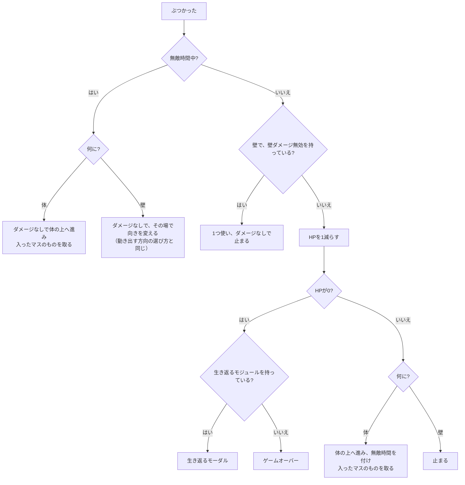

# 3. 実装とアルゴリズム

コードを直す人のためのドキュメント。ゲームが1マス進むときの判定、ぶつかったときの分岐、ものを置く場所の選び方などを、処理の順に書く。ファイルの配置は[2. 構成とつながり](./2-構成とつながり.md)、なぜそのルールにしたかは[議論の記録](../discussions/)を参照する。

関数は、特に断りがなければ`src/logic/game.ts`にある。

## 時間の進め方

ゲームループはフレームごとに前のフレームからの経過ミリ秒を`step`に渡す。経過時間が100ミリ秒を超えたら、100ミリ秒として数える（`loop/frame.ts`の`MAX_FRAME_MS`）。そのため、処理が一時的に止まっても、スネークが何マスも飛んだり、制限時間が一度に大きく減ったりはしない。一方で、重い環境では制限時間が実際の時間より少しゆっくり減る。

`step`は局面ごとに処理を分ける。

- `awaitingStart`: 方向キーが押されるまで何もしない。押されたら、その方向を向いて`playing`になる（`startPlaying`）。時間は減らない
- `playing`: 入力を溜めてから（`enqueue`）、時間を進める（`advance`）。最後に残り時間が0以下ならタイムアップでゲームオーバーにする（`checkTimeUp`）
- `paused`: 真後ろ以外の方向キーで`playing`に戻る（`resume`）。時間は減らない
- それ以外: 何もしない。生き返るモーダルやクリアのモーダルのあいだは、時間が減らない

`advance`は、残り時間から経過時間を引き、移動の待ち時間（`sinceLastMoveMs`）に経過時間を足す。待ち時間が移動の間隔に達したら、間隔ぶんを引いて1マス進む（`moveOneCell`）。止まっているあいだは移動の待ち時間を足さず、止まる時間を減らす（`recover`）。どちらのあいだも、制限時間は減る。

## 入力の溜め方

`enqueue`は、そのフレームに押された方向を、動きの状態の`queuedInputs`に溜める。

- 動いているあいだ: 押された順に、最大`inputQueueLimit`（既定は2）個まで溜める。1マス進むたびに先頭を1つ使うので、1マス進むあいだに2回押した曲がり方（右に進みながら上→左と押すUターンなど）も、1マスずつ順に反映される。溜まっている最後の方向（なければ今の向き）の真後ろは捨てる
- ぶつかって止まっているあいだ: 最後に押した方向だけを覚える。止まる前の向きの真後ろ（首の方向）は捨てる。止まる時間が終わったら、その方向に動き出す

## 1マス進むとき

`moveOneCell`の処理は次のとおり。

1. 溜まった入力があれば、先頭の方向に向きを変える
2. 頭の次のマスに何があるかを調べる（`obstacleAt`）
   - 盤面の外か壁なら「壁」
   - 体なら「体」。ただし、このマスで体が伸びきっている（体の長さが長さに達している）なら、尻尾は同時に抜けるので、尻尾のマスは体として数えない
3. 壁か体なら、ぶつかったときの処理に進む（`collide`）
4. 何もなければ頭を進め（`enter`）、入ったマスのものを取る（`arrive`）

`enter`は、新しい頭を先頭に足し、体を長さぶんで切る。ステージの開始直後は体が頭だけなので、進むたびに中央のマスから1マスずつ伸びて、長さに達する。

`arrive`は、頭のマスにあるものを、ゴール、バッテリー、ハートの順に調べて、最初に見つかったものを取る。体をすり抜けて入ったときも、同じく取る。

## ぶつかったときの分岐

`collide`は、無敵時間中か、何にぶつかったか、壁ダメージ無効を持っているかで分かれる。

無敵時間中に壁にぶつかったときは、向きを変えるだけで、その1マスぶんは進まない。

## 止まったあと、動き出す方向

止まる時間が終わると、`recover`が動き出す方向を決め、無敵時間を付ける。止まっているあいだに方向キーが押されていれば、その方向に動き出す。押されていなければ、`randomEscape`が次の順で探し、最初に見つかった候補の中からランダムに選ぶ。

1. すぐ先が壁でも体でもない方向
2. すぐ先が体の方向のうち、真後ろ以外（体はすり抜けられる）
3. 真後ろ（首の方向）
4. 4方向すべて

無敵時間中に壁にぶつかって向きを変えるときも、`randomEscape`で選ぶ。

## バッテリーを食べたとき

`eatBattery`は、次の順に計算する。

1. 次のバッテリーを置く。モジュール「PP2倍のバッテリー」の確率で、PP2倍の種類にする
2. 食べた数が`batteriesToGoal`に達し、まだゴールがなければ、ゴールを置く
3. 得るPPを計算する。バッテリー1個のPP×「PP・伸び2倍」の倍率（1＋持っている数）×（PP2倍のバッテリーなら2）
4. 長さを、「PP・伸び2倍」の倍率ぶん伸ばす
5. ハートを置く数を決める。累計獲得PPが`heartEveryTotalPp`の倍数を何回またいだか、に、`heartWithBatteryChance`の確率で1個足す

スコアのバッテリーの分はクリアするときに食べた数×係数で計算する。PPの倍率は掛けない。

## ものを置く場所

バッテリー、ゴール、ハートは、`logic/board.ts`の`placeableCells`が返すマスから、ランダムに1つ選ぶ（`spawnCell`）。

- まず、壁、ほかのもの、体、中央のマスのどれとも重ならない空きマスを探す
- 空きマスがなければ、頭を除く体のマスのうち、ほかのものがないマスを使う。ものを取るのは頭だけなので、体の上に置いても取られない。描くときは、体の上のものを体より手前に描く

置ける場所がまったくないとき、ハートは出すのをやめる。バッテリーとゴールは、そのまま選ぼうとして例外になる。置ける場所がまったくなくなるのは、空きマスがなく、しかも頭以外の体のマスすべてに、ほかのものが載っているときだけなので、ふつうに遊んでいて起きることはまずない。

## クリア

`clearStage`は、クリアの内訳を作り、スコアに足す。

- バッテリーの分: このステージで食べた数×`scorePerBattery`
- タイムボーナス: 残り時間を秒に切り上げた数×`timeBonusPerSecond`。画面の残り時間の表示も切り上げなので、「0:05」でゴールしたら5秒分になる
- クリアにかかった時間: 制限時間から残り時間を引いたもの

## ステージの始め方

`enterStage`（`startRun`と`nextStage`から呼ぶ）は、次の順にステージを作る。

1. 数値の中の壁のパターンから、ランダムに1つ選び、盤面に置く
2. 中央のマスに頭だけを置く
3. モジュールの効果から制限時間を計算する
4. 最初のバッテリーを置く
5. 「制限時間延長（次のステージ）」を、ここで使い切る。3で効果を計算したあとに外すので、延長はこのステージに効く

ハートは持ち越さず、空から始める。

## 生き返るとき

`revive`は、選んだモジュールを1つ使い、`logic/modules.ts`の`REVIVE_HP`でHPを決める（完全回復ならHPの上限、一部回復なら1）。中央のマスに頭だけを置いて`awaitingStart`に戻る。長さ、壁、バッテリー、ゴール、ハート、残り時間はそのまま残る。無敵時間は付けない。

## モジュールの効果

`logic/modules.ts`の`effectsOf`が持っているモジュールの数から効果を計算する。状態には書き込まないので、使い切って減れば、効果も自動で減る。

| モジュール | 効果の計算 | 使い切るか |
|---|---|---|
| PP・伸び2倍 | 倍率＝1＋持っている数（2つで3倍） | 使い切らない |
| 1回復活（完全回復・一部回復） | 生き返るモーダルで選ぶ | HPが0になって選んだら1つ使う |
| 制限時間延長（永続） | 制限時間に、持っている数×`timeLimitPlusMs`を足す | 使い切らない |
| 制限時間延長（次のステージ） | 制限時間に、持っている数×`timeLimitBoostMs`を足す | 次のステージを始めるときに全部使う |
| 壁ダメージ無効 | 壁にぶつかったとき、ダメージの代わりに1つ使う | 使ったら1つ減る |
| HPの上限＋1 | HPの上限に、持っている数を足す | 使い切らない |
| PP2倍のバッテリー | 確率＝持っている数×`doublePpBatteryChancePerStack` | 使い切らない |

## モジュール選択

`logic/shop.ts`の処理は次のとおり。

- 候補の引き方（`drawOffers`）: 今持っている数が上限（`maxStack`）に達していないモジュールから、重ならないように`shopOfferCount`（既定は3）個選ぶ。上限は今持っている数で数えるので、使い切ったモジュールはまた買える
- 買う（`buyModule`）: PPを払い、持っているモジュールと買った記録に足す。「HPの上限＋1」なら、増えた上限の分だけ今のHPも増やす。候補を全部買い切ったら、無料で引き直す
- リロール（`reroll`）: `rerollPrice`を払い、候補を全部引き直す

## 乱数

乱数はシード付き（mulberry32。`logic/rng.ts`）で、状態はランの`rng`に持つ。乱数を使う関数は使ったあとの状態を返し、次の処理に渡す。同じシードと同じ入力なら、同じ展開になる。新しいランのシードだけは`main.tsx`で`Math.random`から作る。

## 壁のパターン

壁のパターンは`#`（壁）と`.`（床）の文字の絵で書く（`logic/wallPatterns.ts`）。

- 検査（`checkWallPattern`）: 空でない、`#`と`.`以外の文字がない、行の長さがそろっている、パターンの中央のマスとそのまわり（3×3）に壁がない、の4つを満たせば使える
- 置き方（`placeWallPattern`）: パターンの中央（幅と高さをそれぞれ2で割って切り捨てた位置）を盤面の中央に合わせ、盤面からはみ出した壁は捨てる。盤面の大きさを変えても、パターンを使い続けられる

## 盤面の描き方

`render/draw.ts`と`render/sprites.ts`の決まりは次のとおり。

- 点滅: 止まっているあいだは止まる残り時間、無敵時間中は無敵の残り時間を100ミリ秒ごとに区切り、交互に消す（`snakeVisible`）。止まっているあいだは、スネークの画像に止まっているときの色を重ねて描き、無敵時間の点滅と見分ける（`tinted`）
- スネークの絵: 頭から数えて、頭、体1、体2、体1、体2…と交互に並べる。1マス進むと各マスの体1と体2が入れ替わり、這っているように見える。各マスは頭の側のマスへ向かう向きに回す（`snakeParts`）
- 壁の絵: 下のマスも壁なら上面だけの絵、そうでなければ手前の側面がある絵を使う。側面の分は下のマスにはみ出して描くので、上の行から順に描く（`wallSprite`）
- 床: 中央のマスは中央のタイル、それ以外は明るいタイルと暗いタイルを市松模様に並べる（`floorTile`）

## 音の選び方

`audio/cues.ts`の決まりは次のとおり。

- 効果音（`soundsFor`）: バッテリーとハートは取る音、ダメージを受けたぶつかり（`damaged: true`）はダメージの音、ゴールが出た・生き返った・クリアは、それぞれの音。ゲームオーバーの音は、イベントではなく局面がゲームオーバーに変わったことで鳴らす（諦めたときはイベントが出ないため）
- BGMの音量（`bgmLevel`）: タイトル、ゲームオーバー、クリアのモーダル、モジュール選択では、設定した音量の5割にする

## 調整のJSONの検査と保存

`tuning/parse.ts`の`parseTuningJson`はzodのスキーマで検査する。

- 書いていない項目は既定値で埋める
- 使えない値（範囲外、整数でない、数でない）か、知らない項目が1つでもあれば、全体を読み込まず、どの項目がなぜ使えないかを返す
- 値の決まり（最小・最大・整数か）は`tuning/fields.ts`の`Rule`にあり、スキーマも調整パネルの入力欄の検査（`satisfies`）も、そこから作る

`tuning/storage.ts`は既定値から変えた項目だけを保存する。壁のパターンは、1つでも違えば一覧ごと保存する。読むときは`parseTuningJson`を通すので、保存していない項目はそのときの既定値になる。
