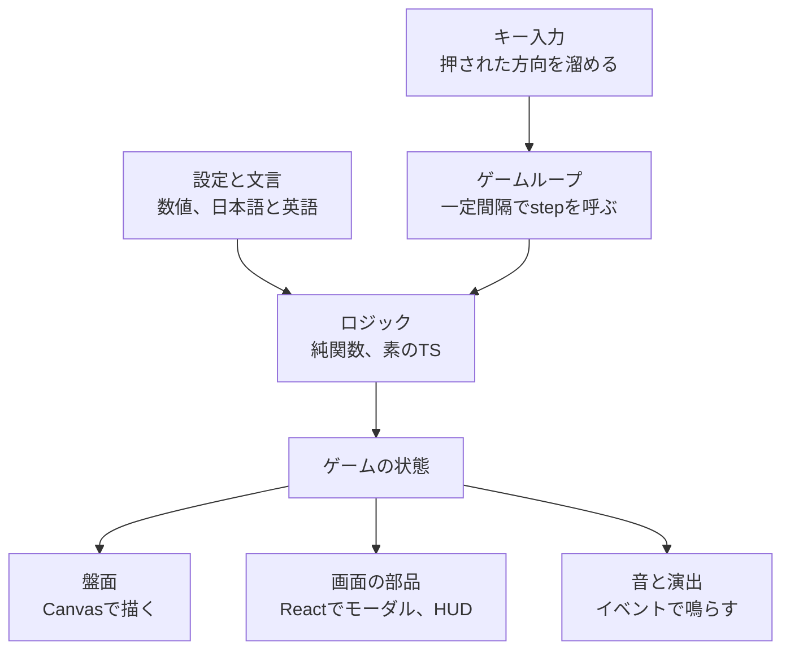

# ゲームの状態の設計

[concept.md](./concept.md)のルールを実装するときの、ゲームの状態の持ち方と、ロジックの動き方。言葉の意味は[用語集](../GLOSSARY.md)にそろえる。

## 全体の構成

- ロジックは素のTSの純関数にし、Reactにも描画にも依存させない
- 盤面、画面の部品、音と演出は、状態とイベントを読んで表示するだけで、状態を直接書き換えない
- 画面の操作（モジュールを買う、次のステージへ進むなど）も、ロジックの関数を呼んで新しい状態を受け取る

## 状態の分け方

### ランの状態

ステージをまたいで持ち越すもの。

- 長さ（ラン開始時は3）
- HP（初期値は3）と、HPの上限
- 所持PPと、累計獲得PP
- スコア
- 持っているモジュールの一覧。使うと減るもの（1回生き返る、次のステージだけ延長、壁ダメージ無効など）は、残り回数を持つ
- 到達ステージ番号
- 乱数の状態

### ステージの状態

ステージごとに作り直すもの。

- 体と向き
- 溜まった入力（2つまで）
- 壁、バッテリー、ゴール、ハート
- 残り時間
- 食べたバッテリーの数
- ぶつかって止まっているかどうか
- 無敵の残り時間

### 局面

ラン中の局面は、ロジックの状態が持つ。Reactは局面を見て、どの画面を出すか選ぶだけにする。タイトル画面はランが始まる前なので、Reactが持つ。

- ステージ開始待ち
- ステージ中
- 生き返るモーダル
- クリアのモーダル
- モジュールの画面
- ゲームオーバー

ぶつかって止まっている状態は、局面を分けず、「ステージ中」の中で持つ。

### モジュールの効果

モジュールの効果は、持っているモジュールの一覧から毎回計算する。HPの上限や制限時間の数値を、買ったときに直接書き換えない。

## ロジックの動き

- `step(状態, 入力, 経過ミリ秒)`が、新しい状態と、起きたことのイベントを返す
- 時間はミリ秒で数える。スネークは、溜まった時間が移動の間隔を超えたら1マス進む。移動速度を変えるモジュールがあっても、制限時間や無敵時間の減り方は変わらない
- 乱数はシード付きにし、同じシードなら同じ展開になるようにする
- イベントは次のとおり。足りないものは作りながら足す
  - バッテリーを食べた
  - ぶつかった
  - ハートを取った
  - ゴールが出た
  - クリアした
  - HPが0になった
  - 時間切れ
  - 生き返った

## 細かい決まり

- ステージ開始時は、最初の方向キーを押すまで中央のマスで待つ。待っているあいだは「方向キーで開始」のように表示する。押した瞬間に進み出し、制限時間も減り始める
- ぶつかって止まっているあいだも、制限時間は減る
- 無敵時間中に壁や体にぶつかったら、ダメージなしで、止まらずにその場でランダムに向きを変える（向きの選び方は、ぶつかったあとに動き出すときと同じ）
- HPが0になったとき、生き返るモジュールを持っていなければ、生き返るモーダルを出さずにゲームオーバーにする
- クリアのモーダルにボタンを置き、押したらモジュールの画面に移る
- 「壁ダメージ無効」は、最初の完成ラインでは、ぶつかったら1回分を消費する形だけを作る
- 「PP2倍のバッテリー」を食べても、スコアのバッテリーの分は2倍にしない
- 累計獲得PPが、ハートの出る基準を一度に複数超えたら、超えた数だけハートを出す
- 真後ろへの入力は無視する
- バッテリー、ゴール、ハートは、壁、体、ほかのもの、中央のマスのどれとも重ならない空きマスから、ランダムに選ぶ
